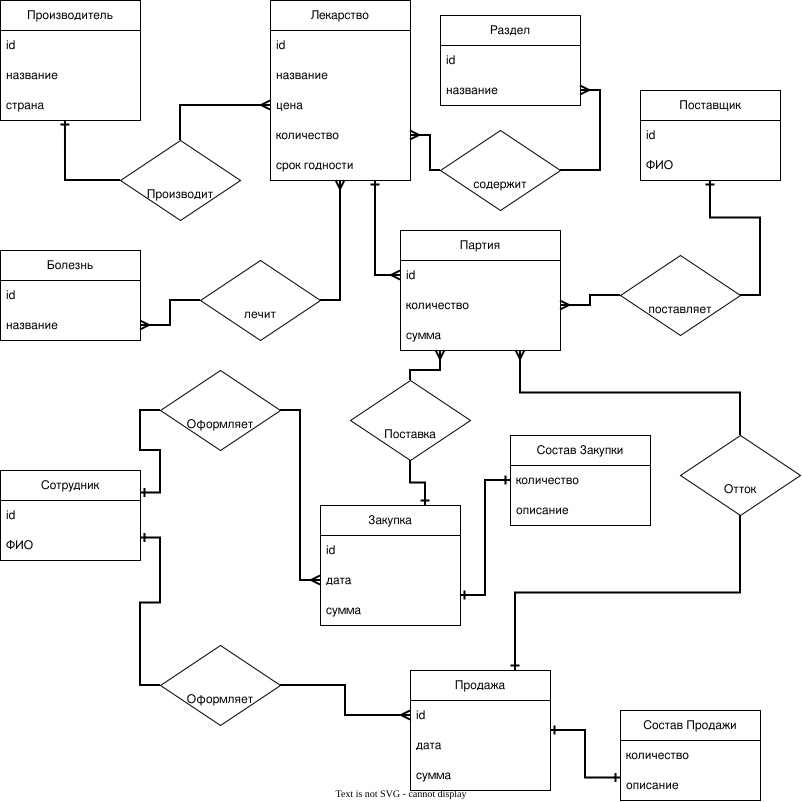

# lab1-Sudb.
Лабораторная №1. ER-модель и реляционная модель
# Лабораторная работа №1
Предметная область: учёт лекарств в аптеке

## 1. ER-диаграмма

## 3. Описание сущностей

### 3.1. Производитель (`manufacturer`)

| Атрибут | Тип | PK | NULL | Ограничения |
|---|---|:-:|:-:|---|
| id | INTEGER | да | нет | автоинкремент, уникален |
| название | VARCHAR(100) | нет | нет | уникально |
| страна | VARCHAR(60) | нет | да | |

### 3.2. Лекарство (`medicine`)

| Атрибут | Тип | PK | NULL | Ограничения |
|---|---|:-:|:-:|---|
| id | INTEGER | да | нет | автоинкремент, уникален |
| название | VARCHAR(100) | нет | нет | |
| цена | NUMERIC(10,2) | нет | нет | `цена >= 0` |
| количество | INTEGER | нет | нет | `количество >= 0`, по умолчанию 0 |
| срок годности | DATE | нет | да | |

### 3.3. Раздел (`section`)

| Атрибут | Тип | PK | NULL | Ограничения |
|---|---|:-:|:-:|---|
| id | INTEGER | да | нет | автоинкремент, уникален |
| название | VARCHAR(100) | нет | нет | уникально |

### 3.4. Болезнь (`disease`)

| Атрибут | Тип | PK | NULL | Ограничения |
|---|---|:-:|:-:|---|
| id | INTEGER | да | нет | автоинкремент, уникален |
| название | VARCHAR(100) | нет | нет | уникально |

### 3.5. Поставщик (`supplier`)

| Атрибут | Тип | PK | NULL | Ограничения |
|---|---|:-:|:-:|---|
| id | INTEGER | да | нет | автоинкремент, уникален |
| ФИО | VARCHAR(150) | нет | нет | |

### 3.6. Сотрудник (`employee`)

| Атрибут | Тип | PK | NULL | Ограничения |
|---|---|:-:|:-:|---|
| id | INTEGER | да | нет | автоинкремент, уникален |
| ФИО | VARCHAR(150) | нет | нет | |

### 3.7. Закупка (`purchase`)

| Атрибут | Тип | PK | NULL | Ограничения |
|---|---|:-:|:-:|---|
| id | INTEGER | да | нет | автоинкремент, уникален |
| дата | DATE | нет | нет | |
| сумма | NUMERIC(12,2) | нет | нет | `сумма >= 0` |

### 3.8. Продажа (`sale`)

| Атрибут | Тип | PK | NULL | Ограничения |
|---|---|:-:|:-:|---|
| id | INTEGER | да | нет | автоинкремент, уникален |
| дата | DATE | нет | нет | |
| сумма | NUMERIC(12,2) | нет | нет | `сумма >= 0` |

### 3.9. Партия (`batch`)

| Атрибут | Тип | PK | NULL | Ограничения |
|---|---|:-:|:-:|---|
| id | INTEGER | да | нет | автоинкремент, уникален |
| количество | INTEGER | нет | нет | `количество > 0` |
| сумма | NUMERIC(12,2) | нет | нет | `сумма >= 0` |

### 3.10. Состав Закупки (`purchase_content`) — слабая сущность

Собственного ключа нет, идентифицируется через сущность «Закупка».

| Атрибут | Тип | PK | NULL | Ограничения |
|---|---|:-:|:-:|---|
| количество | INTEGER | нет | нет | `количество > 0` |
| описание | TEXT | нет | да | |

### 3.11. Состав Продажи (`sale_content`) — слабая сущность

Собственного ключа нет, идентифицируется через сущность «Продажа».

| Атрибут | Тип | PK | NULL | Ограничения |
|---|---|:-:|:-:|---|
| количество | INTEGER | нет | нет | `количество > 0` |
| описание | TEXT | нет | да | |

---

## 4. ER-модель: связи между сущностями

| № | Связь | Сущности | Тип | Обязательность |
|:-:|---|---|:-:|---|
| 1 | Производит | Производитель — Лекарство | 1:M | Лекарство **обязательно** имеет производителя; производитель может не иметь лекарств (необязательно) |
| 2 | Содержит | Лекарство — Раздел | M:N | Лекарство входит **минимум в один** раздел (обязательно); раздел может быть пустым (необязательно) |
| 3 | Лечит | Лекарство — Болезнь | M:N | Необязательна с обеих сторон |
| 4 | Включает | Лекарство — Партия | 1:M | Партия **обязательно** относится к лекарству; у лекарства может не быть партий |
| 5 | Поставляет | Поставщик — Партия | 1:M | Партия **обязательно** имеет поставщика; у поставщика может не быть партий |
| 6 | Поставка | Закупка — Партия | 1:M | Партия **обязательно** поступает в рамках закупки; закупка содержит минимум одну партию |
| 7 | Отток | Продажа — Партия | 1:M | Со стороны Партии необязательна (партия может быть ещё не продана); продажа содержит минимум одну партию |
| 8 | Оформляет (закупки) | Сотрудник — Закупка | 1:M | Закупка **обязательно** оформлена сотрудником; сотрудник может не оформлять закупок |
| 9 | Оформляет (продажи) | Сотрудник — Продажа | 1:M | Продажа **обязательно** оформлена сотрудником; сотрудник может не оформлять продаж |
| 10 | Имеет состав | Закупка — Состав Закупки | 1:1 | Обязательна с обеих сторон (слабая сущность) |
| 11 | Имеет состав | Продажа — Состав Продажи | 1:1 | Обязательна с обеих сторон (слабая сущность) |

---

## 5. Реляционная модель

Обозначения: **PK** — первичный ключ, **FK** — внешний ключ.

### manufacturer (Производитель)

| Атрибут | Тип | Ключ |
|---|---|---|
| id | INTEGER | PK |
| name | VARCHAR(100) | |
| country | VARCHAR(60) | |

### medicine (Лекарство)

| Атрибут | Тип | Ключ |
|---|---|---|
| id | INTEGER | PK |
| name | VARCHAR(100) | |
| price | NUMERIC(10,2) | |
| quantity | INTEGER | |
| expiry_date | DATE | |
| manufacturer_id | INTEGER | FK → manufacturer(id) |

### section (Раздел)

| Атрибут | Тип | Ключ |
|---|---|---|
| id | INTEGER | PK |
| name | VARCHAR(100) | |

### disease (Болезнь)

| Атрибут | Тип | Ключ |
|---|---|---|
| id | INTEGER | PK |
| name | VARCHAR(100) | |

### medicine_section (Лекарство — Раздел)

| Атрибут | Тип | Ключ |
|---|---|---|
| medicine_id | INTEGER | PK, FK → medicine(id) |
| section_id | INTEGER | PK, FK → section(id) |

### medicine_disease (Лекарство — Болезнь)

| Атрибут | Тип | Ключ |
|---|---|---|
| medicine_id | INTEGER | PK, FK → medicine(id) |
| disease_id | INTEGER | PK, FK → disease(id) |

### supplier (Поставщик)

| Атрибут | Тип | Ключ |
|---|---|---|
| id | INTEGER | PK |
| full_name | VARCHAR(150) | |

### employee (Сотрудник)

| Атрибут | Тип | Ключ |
|---|---|---|
| id | INTEGER | PK |
| full_name | VARCHAR(150) | |

### purchase (Закупка)

| Атрибут | Тип | Ключ |
|---|---|---|
| id | INTEGER | PK |
| purchase_date | DATE | |
| total | NUMERIC(12,2) | |
| employee_id | INTEGER | FK → employee(id) |

### sale (Продажа)

| Атрибут | Тип | Ключ |
|---|---|---|
| id | INTEGER | PK |
| sale_date | DATE | |
| total | NUMERIC(12,2) | |
| employee_id | INTEGER | FK → employee(id) |

### batch (Партия)

| Атрибут | Тип | Ключ |
|---|---|---|
| id | INTEGER | PK |
| quantity | INTEGER | |
| total | NUMERIC(12,2) | |
| medicine_id | INTEGER | FK → medicine(id) |
| supplier_id | INTEGER | FK → supplier(id) |
| purchase_id | INTEGER | FK → purchase(id) |
| sale_id | INTEGER (может быть NULL) | FK → sale(id) |

### purchase_content (Состав Закупки)

| Атрибут | Тип | Ключ |
|---|---|---|
| purchase_id | INTEGER | PK, FK → purchase(id) |
| quantity | INTEGER | |
| description | TEXT | |

### sale_content (Состав Продажи)

| Атрибут | Тип | Ключ |
|---|---|---|
| sale_id | INTEGER | PK, FK → sale(id) |
| quantity | INTEGER | |
| description | TEXT | |

---

- Поле `batch.sale_id` допускает `NULL`, пока партия не продана.
